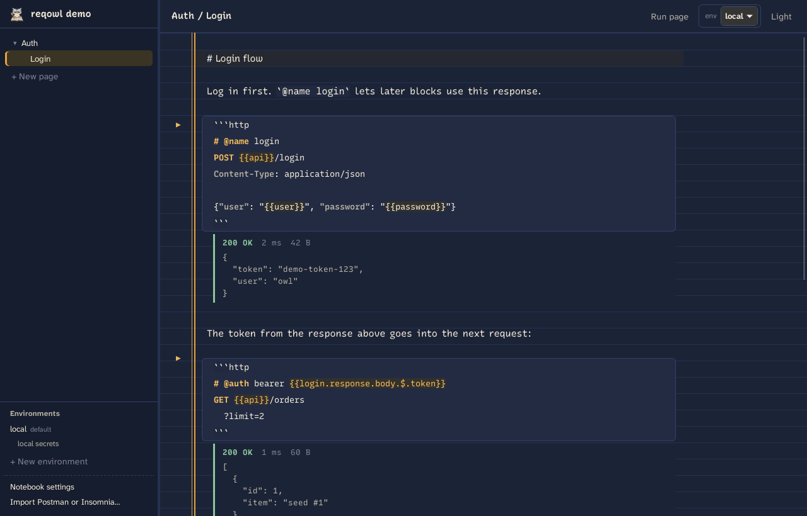
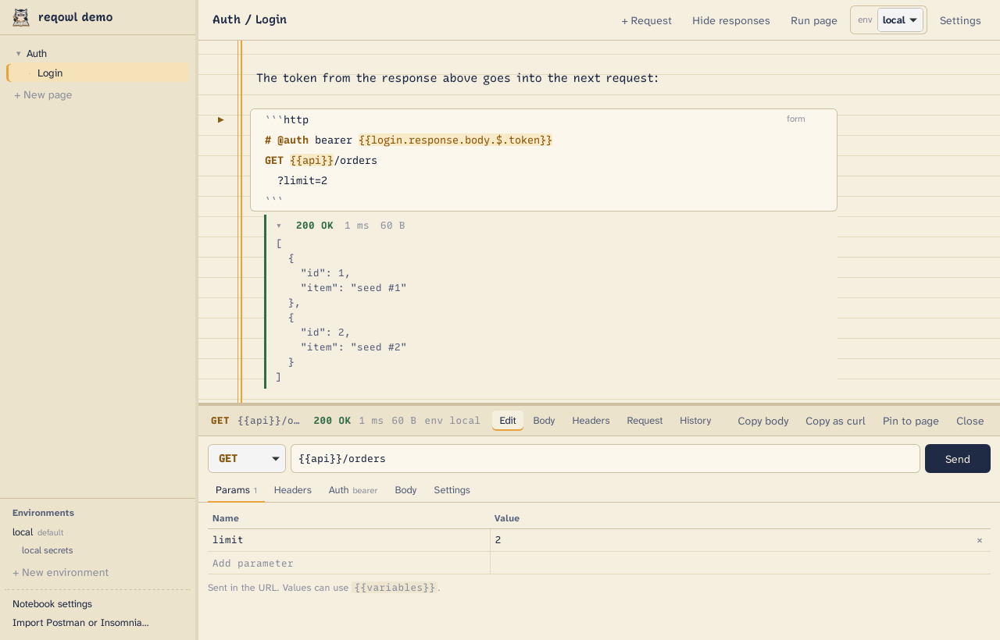
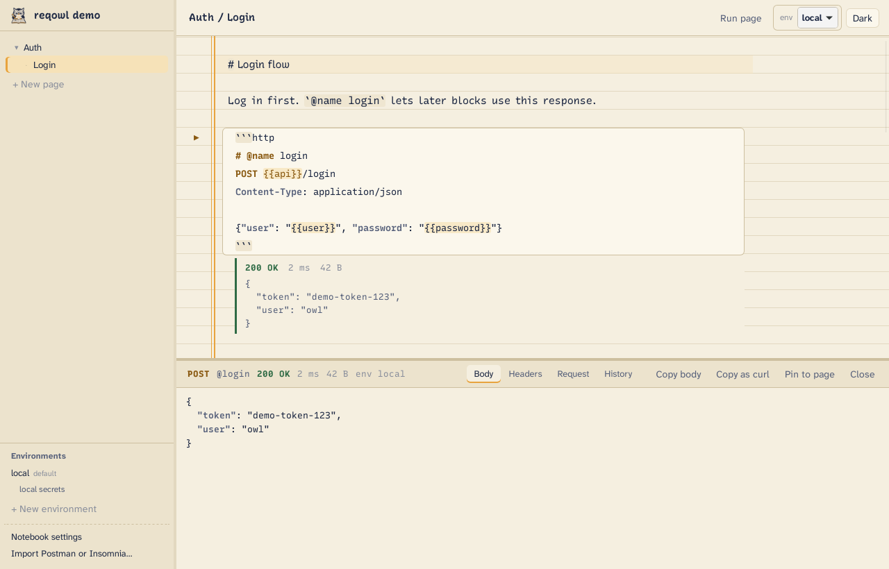
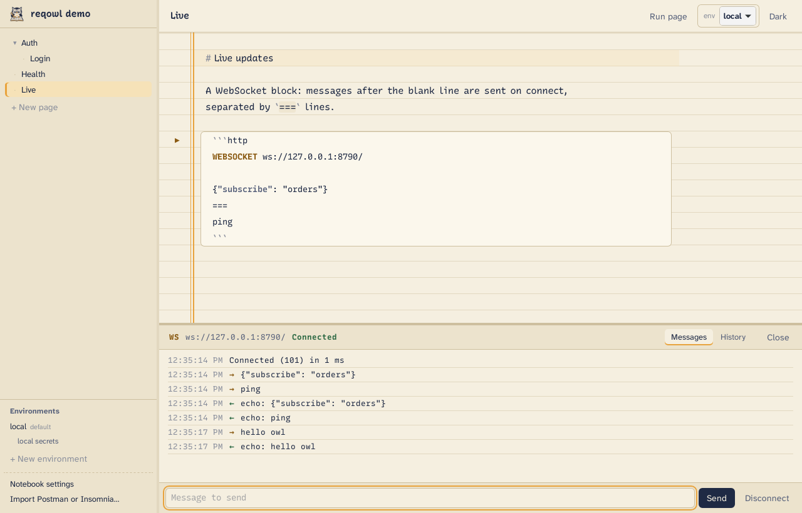
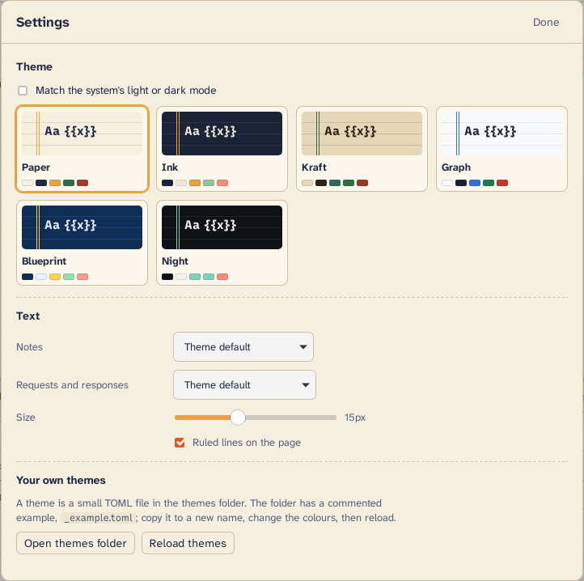

# reqowl


**A notebook for APIs.** Pages are Markdown files in a folder tree. Any
` ```http ` block in a page is a request you can run, and its response shows
up right under it. Notes and requests live together, in plain files that
diff cleanly in git. Runs on Linux, macOS and Windows.



- **Notes first.** Write the why next to the request: setup steps, gotchas, links.
- **Plain files.** A notebook is a folder: `.md` pages, `env/*.toml` environments. No account, no cloud.
- **Familiar syntax.** Blocks use the VS Code REST Client / JetBrains HTTP Client format.
- **Chaining.** Name a block and use its response later: `{{login.response.body.$.token}}`. Running a block runs what it depends on.
- **Secrets stay out of git** in `env/*.local.toml`, and are hidden in history.
- **HTTP, GraphQL, WebSocket, OAuth2** (client credentials, authorization code with PKCE, password).
- **Import** Postman collections and environments, Insomnia exports (v4 JSON, v5 YAML), and curl commands. Paste a curl command into a page and it becomes a block.
- **Form or code.** Edit any request as a form (params, headers, auth, body) or as text; both stay in sync.
- **Themes.** Six built-in themes, your choice of fonts and text size, and your own themes as small TOML files.
- **A CLI** that runs the same pages, for scripts and CI.

> Status: early. Everything above works; expect rough edges. See
> [Limitations](#limitations).

## Install

Installers for Linux (`.deb`, `.rpm`, AppImage), macOS (`.dmg`) and Windows
(`.msi`, `.exe`) will be attached to each [release](../../releases), starting
with the first one. Until then, build one yourself; see [Building](#building).

On Debian or Ubuntu, after building:

```sh
sudo apt install ./target/release/bundle/deb/reqowl_0.1.0_amd64.deb
reqowl-app ~/notes/my-api        # or open it from the app menu
```

## Using the app

Open a folder as a notebook, create one, or import a Postman or Insomnia
export from the start screen. Pages save as you type.

### Writing requests

Add a ` ```http ` block anywhere in a page, or click **+ Request** in the top
bar. Run it with ▶ in the margin or `Ctrl+Enter`; the response appears under
the block. A block that uses `{{name.response…}}` runs the named block first
if it hasn't run yet. Paste a curl command into a page and it becomes a
block.

### Or fill in a form

Every block can also be edited as a form: click its **form** link or press
`Ctrl+E`. The panel's Edit tab has the method and URL, query params,
headers, auth (bearer, basic, API key, OAuth2), the body (JSON, text, form
fields or GraphQL) and settings (name, timeout, redirects, TLS checks). The
form writes the block's text as you type and picks up changes you make to
the text, so you can switch between the two at any time. Comments in the
block are kept.



### Responses

Fold a response to its status line with ▾, or all of them with **Hide
responses**; the choice is remembered per page. Click a response to open
the panel with its body, headers, the request as sent, and the block's
history. The last response of every block comes back when you reopen a
page, from the run history in `.reqowl/` (git-ignored, 50 runs per block).

"Pin to page" writes a response into the page as a ` ```response ` block, so
an example response can live in the notes. Values from `*.local.toml` files
and `Authorization` headers are hidden in history and in pinned responses.



### Pages

Drag pages in the tree to reorder or nest them; double-click or `F2` to
rename; right-click for more. Deleted pages go to `.reqowl/trash/` in the
notebook.

### Shortcuts

| | |
|---|---|
| Run the block under the cursor | `Ctrl+Enter` (`⌘+Enter` on macOS), or ▶ in the margin |
| Run every block on the page | `Ctrl+Shift+Enter` |
| Stop a run | `Esc` |
| Edit the block as a form | `Ctrl+E` |
| Show or hide the response panel | `Ctrl+J` |
| Go to page | `Ctrl+P` |
| New page | `Ctrl+N` |
| Rename a page | `F2` |
| Settings | `Ctrl+,` |

## Page syntax

````markdown
# Login flow

```http
# @name login
POST {{base}}/login
Content-Type: application/json

{"user": "{{user}}", "password": "{{password}}"}
```

```http
# @auth bearer {{login.response.body.$.token}}
GET {{base}}/orders?limit=2
```
````

Request syntax follows VS Code REST Client / JetBrains HTTP Client:
`METHOD URL`, headers, a blank line, then the body.

| Directive | Meaning |
|---|---|
| `# @name login` | Later blocks can use `{{login.response.body.$.path}}`, `.status`, `.headers.Name` |
| `# @auth bearer T` / `basic U P` / `apikey Header V` | Sets the auth header |
| `# @auth oauth2 api` | Gets a token for the OAuth2 profile `api` (see below) |
| `# @timeout 10s` | Default 30s |
| `# @no-redirect`, `# @insecure` | Don't follow redirects / skip TLS checks |

Built-ins: `{{$uuid}}`, `{{$timestamp}}`, `{{$isoTimestamp}}`, `{{$randomInt 1 100}}`.
`GRAPHQL url` sends the body as a GraphQL query (variables JSON after a blank line).

### WebSocket

````markdown
```http
WEBSOCKET wss://{{host}}/socket
Authorization: Bearer {{token}}

{"subscribe": "orders"}
===
{"subscribe": "prices"}
```
````



Headers go on the handshake (`@auth` works as usual). The body holds the
messages to send once the connection opens, separated by lines that are
exactly `===`. `@timeout` limits the handshake only; `@insecure` accepts any
certificate. The CLI prints what it sends (`→`) and receives (`←`) for
`--ws-wait` seconds (default 3), then closes.

### OAuth2

`# @auth oauth2 api` takes its settings from variables named `api.<setting>`,
so they can differ per environment and secrets can live in the local file.
Quote the keys: unquoted dotted keys are TOML tables.

```toml
# env/dev.toml
"api.grant" = "client_credentials"     # or authorization_code, password
"api.token_url" = "https://auth.example.com/oauth/token"
"api.client_id" = "reqowl"
"api.scope" = "orders:read"

# env/dev.local.toml
"api.client_secret" = "..."
```

| Setting | |
|---|---|
| `grant` | `client_credentials`, `authorization_code` or `password` |
| `token_url`, `client_id` | Required |
| `client_secret`, `scope`, `audience` | Optional; sent in the form body |
| `auth_url` | Required for `authorization_code` |
| `username`, `password` | Required for `password` |
| `redirect_port` | `authorization_code` only; default 0 (any free port) |

`authorization_code` uses PKCE and opens the sign-in page in your browser
(the CLI prints the URL too); the redirect URI is
`http://127.0.0.1:<port>/callback`, so register that with the provider, with
a fixed `redirect_port` if it needs an exact match. Tokens are kept in memory
until shortly before they expire, then renewed with the refresh token if
there is one.

## Workspace

```
my-api/
  reqowl.toml          # name, default_env, [vars] defaults
  env/dev.toml         # environment variables
  env/dev.local.toml   # secrets; git-ignored
  Auth.md
  Auth/Login.md
```

Variable lookup order: page front matter, `env/<name>.local.toml`,
`env/<name>.toml`, `[vars]` in `reqowl.toml`.

## Themes and fonts

Settings (`Ctrl+,`) has six built-in themes: Paper, Ink, Kraft, Graph,
Blueprint and Night. It can follow the system's light/dark mode with a theme
for each, and lets you pick the fonts for notes and for requests, the text
size, and whether the page is ruled.



Your own themes are small TOML files in the app's themes folder (**Settings →
Open themes folder**); it starts with a commented example. Every colour key
is listed in [docs/themes.md](docs/themes.md).

## Import

In the app: **Import Postman or Insomnia…** at the bottom of the sidebar
(or on the start screen), then pick an empty folder for the new notebook.
Each request becomes a page; folders become pages with children; Postman
and Insomnia environments become `env/*.toml` files, with secret values in
`env/*.local.toml`. Scripts aren't run; they are kept on the page as notes.

## CLI

Install it with `cargo install --path crates/reqowl-cli`, or run it from
the repository:

```sh
python3 scripts/demo-server.py &          # demo API on :8787
cargo run -p reqowl-cli -- run examples/demo/Auth/Login.md
cargo run -p reqowl-cli -- run examples/demo/Auth/Login.md --block login -i
cargo run -p reqowl-cli -- blocks examples/demo/Auth/Login.md
cargo run -p reqowl-cli -- envs examples/demo
```

Exit status: 0 if every block ran and got a response below 400; 1 if a block
failed or got 4xx/5xx; 2 if the page or workspace could not be loaded
(missing file, unknown environment).

## Building

You need Rust (stable) and Node.js 22.

```sh
# Linux only: system libraries for the webview
sudo apt install libwebkit2gtk-4.1-dev libsoup-3.0-dev librsvg2-dev libayatana-appindicator3-dev libxdo-dev

npm ci
npm run tauri dev            # run the app
npm run tauri build          # installers in target/release/bundle/
cargo test --workspace && npm test
```

`reqowl-app <folder>` opens a notebook directly. On Linux the app turns off
WebKit's DMA-BUF renderer, which leaves the window blank on some GPU
drivers; set `WEBKIT_DISABLE_DMABUF_RENDERER=0` to keep it on.

Layout: `crates/reqowl-core` (parsing, variables, HTTP/WebSocket/OAuth2,
history, import), `crates/reqowl-cli`, `src-tauri` (desktop shell),
`ui` (Svelte + CodeMirror).

## Limitations

- Installers are not code-signed yet: macOS will ask you to allow the app
  in System Settings, Windows SmartScreen will warn.
- The macOS and Windows builds haven't been tried on real machines yet.
- OAuth2 tokens live in memory, so you sign in again after a restart.
- No request scripting (pre-request/test scripts); imported scripts are kept as notes.
- WebSocket messages can only be sent as text.

## License

Apache-2.0
